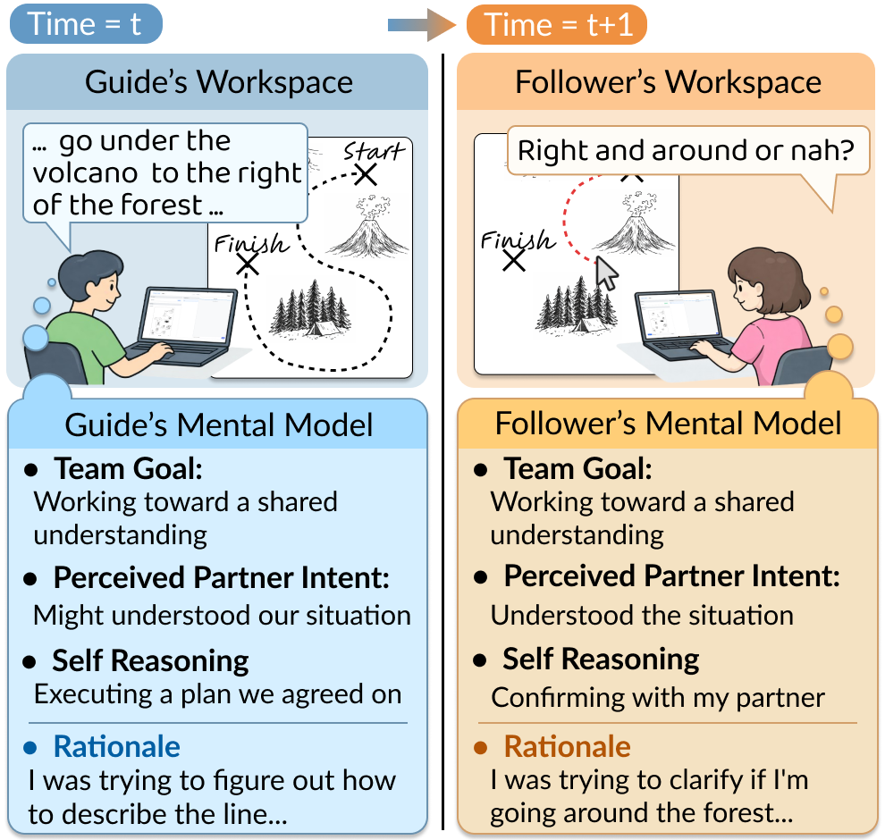
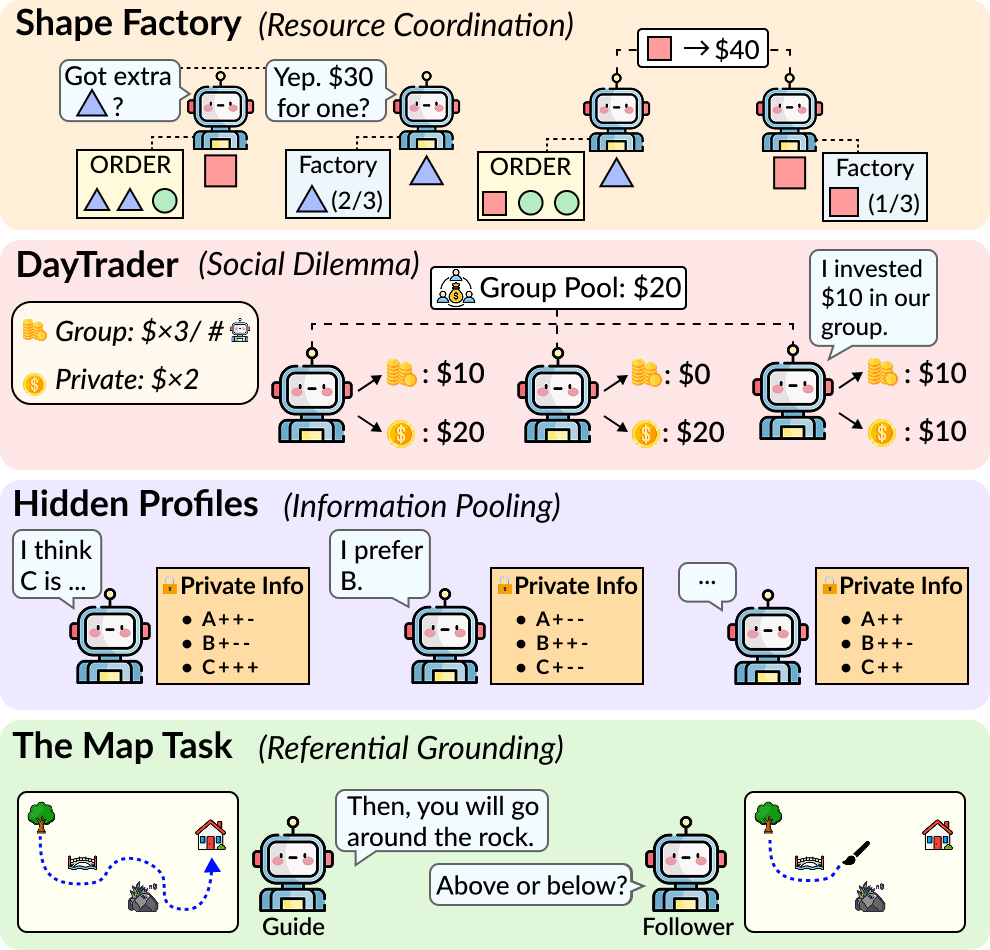
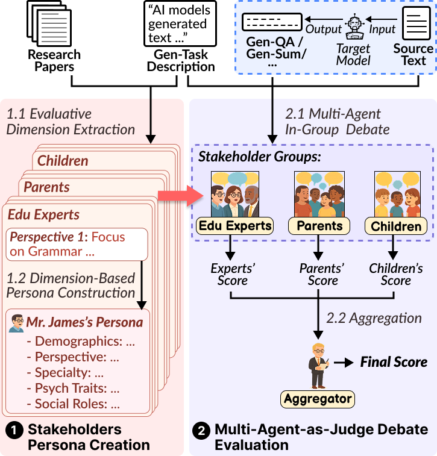
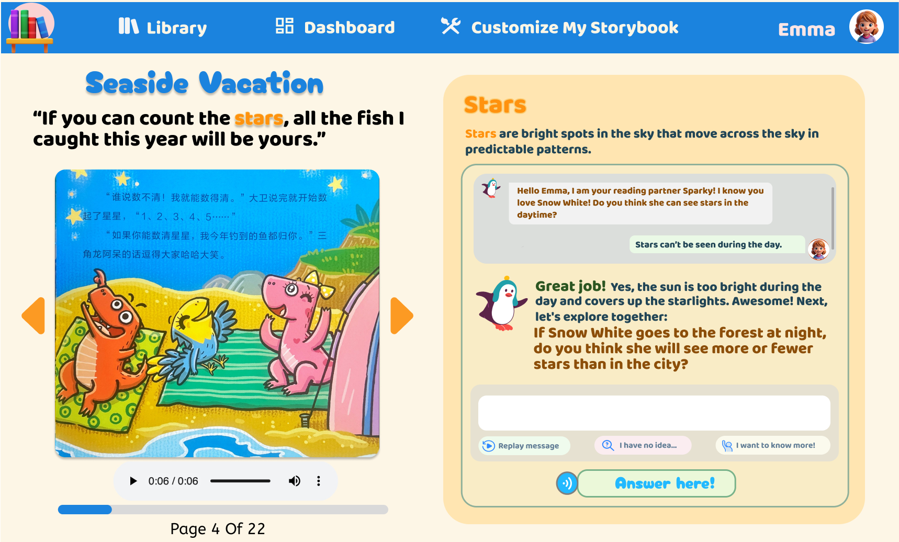
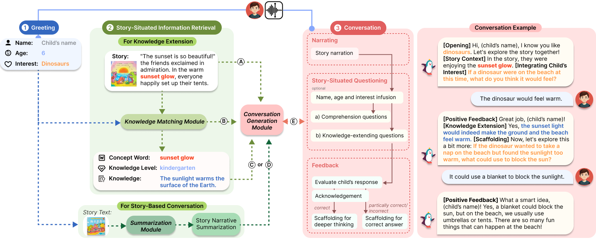
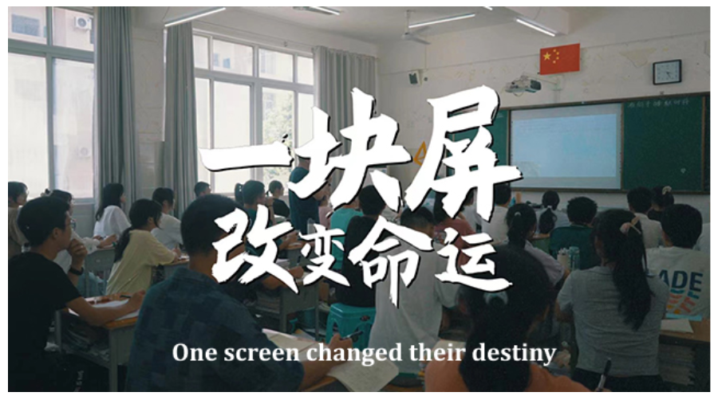
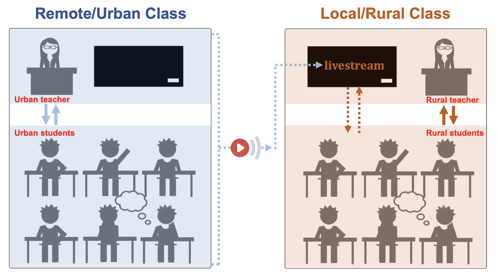
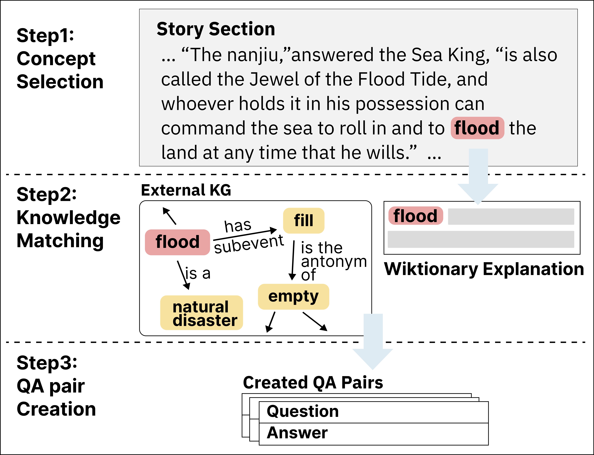
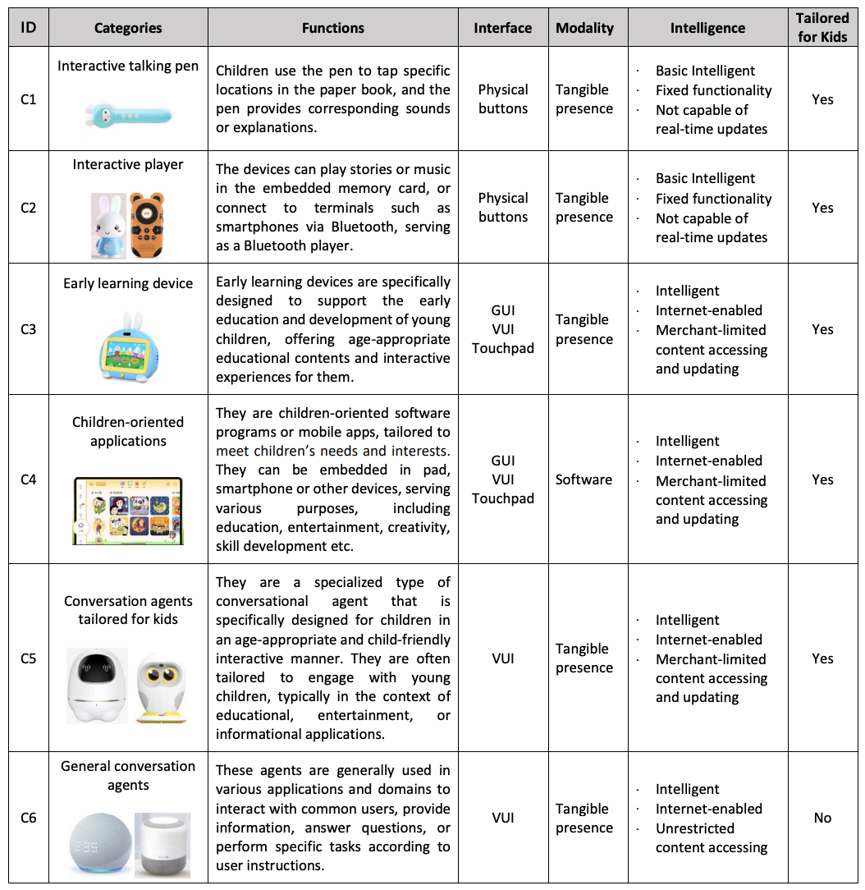

Hi! My name is Jiaju Chen, a Ph.D. student at Northeastern University, advised by Prof. [Dakuo Wang](https://www.dakuowang.com/). 

My research focuses on **Human-Centered AI** design of NLP applications for domain-specific scenarios, including personalized LLM-powered systems for children's education [[CHI '25]](https://dl.acm.org/doi/10.1145/3706598.3713275), dataset for evaluating LLMs' capability to generate educational-appropriate content [[EMNLP '24]](https://aclanthology.org/2024.emnlp-main.961/). Recently, I have been working on investigating the collaboration dynamics between human and **LLM Agents** [[CHI '26]](https://arxiv.org/pdf/2509.18008).

I also work at the Child-Centered AI Lab at Harvard University, advised by Prof. [Ying Xu](https://ying-xu.com/). During my undergraduate study, I worked closely with Prof. [Yuling Sun](https://www.yulingsun.net/).

News
======

  

    

        <strong>04/2026</strong>  ⭐️ My work on Multi-Agent-as-Judge is accepted by ACL 2026. See
      

      

      <strong>01/2026</strong>  ⭐️ My work on a Human-Agent Collaboration Platform is accepted by CHI 2026.
    

    

      <strong>04/2025</strong>  🎡 Attending CHI 2025 in Yokohama and will present our StoryMate paper. I also work as a student volunteer this year.
    

    

      <strong>01/2025</strong>  ⭐️ Two papers <strong>StoryMate</strong> and <strong>Live-Streaming-Based Dual-Teacher</strong> are accepted by CHI 2025. See you in Yokohama!
    

    

      <strong>11/2024</strong>  🌴 Attended EMNLP 2024 at Miami, Florida, USA.
    

    

      <strong>11/2024</strong>  🌋 Attended CSCW 2024 at San Jose, Costa Rica.
    

  

  <button class="show-more-btn" id="showMoreBtn" onclick="toggleNews()">
    <i class="fas fa-chevron-down"></i> Show More
  </button>

Publications
======

  

    <h2>2026</h2>
    

      

        
      

      

        

          
Preprint

          Humans' ALMANAC: A Human Collaboration Dataset of Action-Level Mental Model Annotations for Agent Collaboration
        

        

          <strong>Jiaju Chen</strong>,
          <a href="https://yuxuan.lu/">Yuxuan Lu</a>, Jiayi Su, 
          <a href="https://www.chaoranchen.com/">Chaoran Chen</a>, Songlin Xiao, 
          <a href="https://zhengzhang.me/">Zheng Zhang</a>,
          <a href="https://www.microsoft.com/en-us/research/people/wangyun/">Yun Wang</a>, 
          <a href="https://yunyaoli.github.io/">Yunyao Li</a>,
          <a href="https://www.wvisdomlab.com/">Jian Zhao</a>,
          <a href="https://www.cs.cmu.edu/~sherryw/">Tongshuang Wu</a>,
          <a href="https://toby.li/">Toby Jia-Jun Li</a>,
          <a href="https://www.dakuowang.com/">Dakuo Wang</a>,
          <a href="https://www.bingshengyao.com/">Bingsheng Yao</a>.
        

        
Preprint

        

          <a href="https://arxiv.org/abs/2606.06388" class="button-link">
            <i class="fas fa-file-pdf"></i> Arxiv
          </a>
          <a href="https://human-agent-collab.hailab.io/almanac" class="button-link">
            <i class="fa-solid fa-share-nodes"></i> Project Website
          </a>
        

      

    

    

      

        
      

      

        

          
Preprint

          CollabSim: A CSCW-Grounded Methodology for Investigating Collaborative Competence of LLM Agents through Controlled Multi-Agent Experiments
        

        

          <strong>Jiaju Chen</strong>, Bo Sun,
          <a href="https://yuxuan.lu/">Yuxuan Lu</a>,
          <a href="https://www.microsoft.com/en-us/research/people/wangyun/">Yun Wang</a>, 
          <a href="https://www.dakuowang.com/">Dakuo Wang</a>,
          <a href="https://www.bingshengyao.com/">Bingsheng Yao</a>.
        

        
Preprint

        

          <a href="https://arxiv.org/abs/2606.06399" class="button-link">
            <i class="fas fa-file-pdf"></i> Arxiv
          </a>
          <a href="https://human-agent-collab.hailab.io/collabsim" class="button-link">
            <i class="fa-solid fa-share-nodes"></i> Project Website
          </a>
        

      

    

    

      

        
      

      

        

          
ACL 2026

          Multi-Agent-as-Judge: Aligning LLM-Agent-Based Automated Evaluation with Multi-Dimensional Human Evaluation
        

        

          <strong>Jiaju Chen</strong>,
          <a href="https://yuxuan.lu/">Yuxuan Lu</a>,
          Xiaojie Wang, Huimin Zeng, Jing Huang, Jiri Gesi, 
          <a href="https://ying-xu.com/">Ying Xu</a>, 
          <a href="https://www.bingshengyao.com/">Bingsheng Yao</a>,
          <a href="https://www.dakuowang.com/">Dakuo Wang</a>.
        

        
In Proceedings of the 64th Annual Meeting of the Association for Computational Linguistics.

        

          <a href="https://arxiv.org/abs/2507.21028" class="button-link">
            <i class="fas fa-file-pdf"></i> Arxiv
          </a>
        

      

    

    

      

        
      

      

        

          
CHI 2026

            Through the Lens of Human-Human Collaboration: A Configurable Research Platform for Exploring Human-Agent Collaboration
        

        

          <a href="https://www.bingshengyao.com/">Bingsheng Yao*</a>,
          <strong>Jiaju Chen*</strong>,
          <a href="https://www.chaoranchen.com/">Chaoran Chen</a>,
          <a href="https://aprilwang.me/">April Wang</a>,
          <a href="https://toby.li/">Toby Jia-jun Li</a>,
          <a href="https://www.dakuowang.com/">Dakuo Wang</a>.
        

        
In Proceedings of the CHI Conference on Human Factors in Computing Systems, 2026

        

          <a href="https://arxiv.org/abs/2509.18008" class="button-link">
            <i class="fas fa-file-pdf"></i> Arxiv
          </a>
        

      

    

  

  

    <h2>2025</h2>
    

      

        
        
      

      

        

          
CHI 2025

          Characterizing LLM-Empowered Personalized Story-Reading and Interaction for Children: Insights from Multi-Stakeholder Perspectives
        

        

          <strong>Jiaju Chen</strong>,
          Minglong Tang
          <a href="https://yuxuan.lu/">Yuxuan Lu</a>,
          <a href="https://www.bingshengyao.com/">Bingsheng Yao</a>,
          Elissa Fan,
          <a href="https://www.cse.ust.hk/~mxj/">Xiaojuan Ma</a>,
          <a href="https://ying-xu.com/">Ying Xu</a>, 
          <a href="https://www.dakuowang.com/">Dakuo Wang</a>,
          <a href="https://www.yulingsun.net/">Yuling Sun</a>,
          Liang He.
        

        
In Proceedings of the CHI Conference on Human Factors in Computing Systems, 2025

        

          <a href="https://arxiv.org/abs/2503.00590" class="button-link">
            <i class="fas fa-file-pdf"></i> Arxiv
          </a>
          <a href="https://www.youtube.com/watch?v=mOOor4hOCp0" class="button-link">
            <i class="fa-solid fa-video"></i> Presentation
          </a>
          <a href="https://storymate.hailab.io/" class="button-link">
            <i class="fa-solid fa-circle-play"></i> Demo
          </a>
          <a href="https://github.com/neuhai/storymate" class="button-link">
            <i class="fab fa-github"></i> Code
          </a>
        

      

    

    

      

        
        
      

      

        

          
CHI 2025

          Live-Streaming-Based Dual-Teacher Classes for Equitable Education: Insights and Challenges From Local Teachers' Perspective in Disadvantaged Areas
        

        

          <a href="https://www.yulingsun.net/">Yuling Sun</a>,
          <strong>Jiaju Chen</strong>,
          Xiaomu Zhou,
          <a href="https://www.cse.ust.hk/~mxj/">Xiaojuan Ma</a>,
          <a href="https://www.bingshengyao.com/">Bingsheng Yao</a>,
          Kai Zhang,
          Liang He,
          <a href="https://www.dakuowang.com/">Dakuo Wang</a>.
        

        
In Proceedings of the CHI Conference on Human Factors in Computing Systems, 2025

        

          <a href="https://dl.acm.org/doi/abs/10.1145/3706598.3714232" class="button-link">
            <i class="fas fa-file-pdf"></i> Paper
          </a>
        

      

    

  

  

    <h2>2024</h2>
    

      

        
      

      

        

          
EMNLP 2024

          StorySparkQA: Expert-Annotated QA Pairs with Real-World Knowledge for Children's Story-Based Learning
        

        

          <strong>Jiaju Chen</strong>,
          <a href="https://yuxuan.lu/">Yuxuan Lu</a>,
          <a href="https://shaozhang.info/">Shao Zhang</a>,
          <a href="https://www.bingshengyao.com/">Bingsheng Yao</a>,
          Yuanzhe Dong,
          <a href="https://ying-xu.com/">Ying Xu</a>, 
          Yunyao Li,
          <a href="https://qianwen.info/">Qianwen Wang</a>,
          <a href="https://www.dakuowang.com/">Dakuo Wang</a>,
          <a href="https://www.yulingsun.net/">Yuling Sun</a>,
          Liang He.
        

        
In Proceedings of the 2024 Conference on Empirical Methods in Natural Language Processing

        

          <a href="https://arxiv.org/abs/2311.09756" class="button-link">
            <i class="fas fa-file-pdf"></i> Arxiv
          </a>
          <a href="https://github.com/neuhai/StorySparkQA" class="button-link">
            <i class="fab fa-github"></i> Code
          </a>
          <a href="https://huggingface.co/datasets/NEU-HAI/StorySparkQA" class="button-link">
            <i class="fas fa-database"></i> Dataset
          </a>
        

      

    

    

      

        
      

      

        

          
CSCW 2024

          Exploring Parent's Needs for Children-Centered AI to Support Preschoolers' Interactive Storytelling and Reading Activities
        

        

          <a href="https://www.yulingsun.net/">Yuling Sun</a>,
          <strong>Jiaju Chen</strong>,
          <a href="https://www.bingshengyao.com/">Bingsheng Yao</a>,
          Jiali Liu,
          <a href="https://www.dakuowang.com/">Dakuo Wang</a>,
          <a href="https://www.cse.ust.hk/~mxj/">Xiaojuan Ma</a>,
          <a href="https://yuxuan.lu/">Yuxuan Lu</a>,
          <a href="https://ying-xu.com/">Ying Xu</a>, 
          Liang He.
        

        
In Proceedings of the ACM on Human-Computer Interaction, Volume 8, Issue CSCW2

        

          <a href="https://arxiv.org/abs/2401.13804" class="button-link">
            <i class="fas fa-file-pdf"></i> Arxiv
          </a>
        

      

    

  

